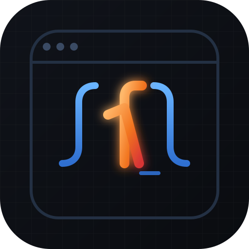
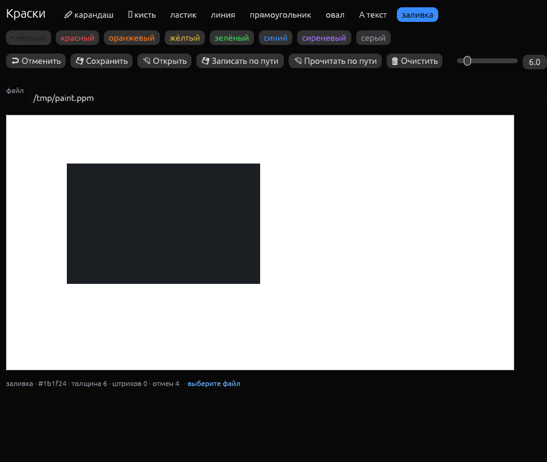
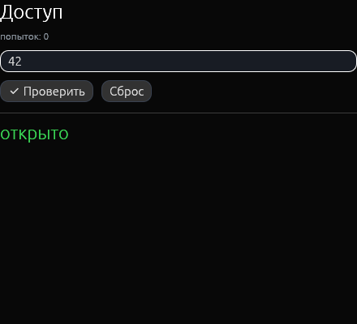
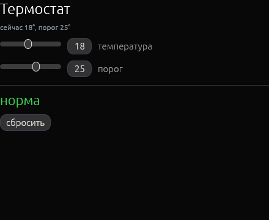
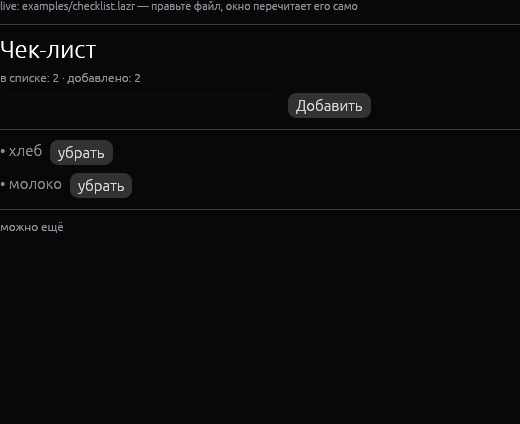

<p align="center">
  
</p>

<h1 align="center">lazr</h1>

<p align="center">
  <b>A UI in 3 ms.</b> A screen model → real egui/eframe code → build → verification by running.<br>
  The model is written as line forms <em>or</em> S-expressions. Rust stays the HAL: window, memory, pixels.
</p>

<p align="center">
  <a href="README.md">Русский</a> · <b>English</b>
</p>

<p align="center">
  <a href="https://github.com/kostyk348/lazr/actions"></a>
  <a href="https://kostyk348.github.io/lazr/index.en.html"></a>
  
  
  
  
</p>

<p align="center">
  
</p>

---

## Why it exists

Lazarus gives a human a canvas: drag a button, double-click, write a handler. **An agent does not need a
canvas** — it needs a semantic way to change the interface and a verifiable result. `lazr` is Lazarus for AI:

```
screen model (form.lazr / *.lisp)  →  real egui/eframe project  →  cargo build  →  verify
```

- **One edit — one fact.** `lazr add DIR button "Plus" --do "count += 1"` changes a model, not an 800-line file.
  Errors arrive as data: line, code, hint.
- **Types are checked before the build.** `append n 1` on an `int` field is the message "«n» is not a list, it is
  int" — not a panic a minute later.
- **Deterministic generation.** One model — one and the same text, so the generated code lives in git and diffs
  cleanly.
- **Verification by running.** `verify` builds the project, renders a headless frame and calls every action,
  printing the effect: `items: [] → ["milk"], done: 0 → 1`.
- **Live mode.** `lazr live FILE` executes the model right now: edit the file, the window follows — no rebuild.

## Speed (measured on this machine)

| Step | Time |
|---|---|
| model → code (`lazr lisp`) | **3 ms** |
| code → built app (warm cache) | **751 ms** |
| edit the model → rebuild | **410 ms** |
| check the actions (`live --check`) | **89 ms** |
| the whole lazr test suite | **18 ms** |
| very first egui build (empty target) | 17 s |

So the loop is: **edit the model, see the result half a second later** — not "restart the IDE and wait".

## Ten minutes to an app

```bash
git clone https://github.com/kostyk348/lazr && cd lazr
cargo install --path .

# 1. live model: edit the file, the window follows
lazr live examples/todo.lisp

# 2. model → real project, then launch it
lazr lisp examples/paint.lisp --to /tmp/paint
lazr run /tmp/paint

# 3. prove it works: build + frame + every action
lazr verify /tmp/paint

# 4. for an agent — the same over MCP
hermes mcp add lazr --command lazr --args mcp
```

## Who it is for

- **Agents and their operators** — when the interface must be edited by commands and verified without a human.
- **Rust GUI developers** tired of `ui.horizontal(|ui| { … })` for every row of layout.
- **People building internal tools**: dashboards, forms, panels, "an admin page in one evening".
- **People who refuse extra installs**: the tool is a single binary with zero dependencies.

## What already works

| | |
|---|---|
| Layout | `vbox`, `hbox`, `grid N`, `scroll`, `space`, `place` with absolute points, sizes and anchors |
| Style | size, weight, colour, padding, alignment, stretch; theme in one line (dark/light, accent, font, radius) |
| Widgets | `label`, `button`, `checkbox`, `text_input`, `slider`, `separator`, `space`, `list`, `custom` |
| State | `int`, `float`, `bool`, `string`, `list` (a list of strings with delete) |
| Logic | `if/else`, comparisons (strings included), arithmetic, `append/remove/clear`, `when … else` in layout |
| Verification | `verify`, `live --check`, `--problems`, `--trace`, two adversarial GUI scripts |
| Packaging | `lazr package` → binary + icon rendered from the logo + `.desktop` + `tar.gz` |
| For agents | an MCP server inside: 8 tools, `lazr mcp` |

## One model, two syntaxes

Line forms suit point edits by a human and the CLI; S-expressions suit a program building the model: one form is
one operation, no quoting or ordering traps, and a handler is a form that can be evaluated.

<table>
<tr><th>form.lazr</th><th>form.lisp</th></tr>
<tr><td><pre>
window "Counter" 420x260
state count int 0
label "Clicks: {count}" {size:22, bold}
button "Plus" do count += 1 {icon:play}
when count >= 3
  label "three already" {size:12, color:#39d353}
else
  label "not yet" {size:12, color:#8b949e}
</pre></td><td><pre>
(window "Counter" 420 260)
(state count int 0)
(label "Clicks: {count}" :size 22 :bold true)
(button "Plus" (set! count (+ count 1)) :icon "play")
(when (>= count 3)
  (label "three already" :size 12 :color "#39d353")
  (else (label "not yet" :size 12 :color "#8b949e")))
</pre></td></tr>
</table>

## Demos

Model → live application. Every demo is machine-checked: `--problems` = 0, `verify` = build + frame + actions.

| File | What it shows |
|---|---|
| `paint.lisp` | Paint: 8 tools, palette, undo, contour fill, files and system dialogs |
| `dashboard.lisp` | Dashboard: absolute `place` layout, anchors, theme, cards |
| `todo.lisp` / `.lazr` | Tasks: a list of strings, `append`/`remove`/`clear`, text input, counters |
| `checklist.lisp` / `.lazr` | Checklist: a row template with `{item}` and its own "remove" button, seeded items |
| `gate.lisp` / `.lazr` | Access: string comparison and conditionally shown panels |
| `thermostat.lisp` | Thermostat: numbers, thresholds and `when … else` |
| `calc.lisp` | Budget: arithmetic in handlers (`*`, `/`), step slider |
| `settings.lisp` | Settings: light theme, checkbox, slider, text input, `do` with two assignments |
| `quiz.lisp` | Quiz: two counters, several actions in one button |
| `live-demo.lisp` / `.lazr` | Runtime showcase: edit the file, the window follows |

<p align="center">
  
  
</p>
<p align="center">
  
</p>

## Lists and row templates

A `list` field is `Vec<String>`; `{items}` in text prints the count. Initial items are listed comma-separated
right in the declaration: `state items list "bread,milk"`.

A row can have a **template of its own**: ordinary widgets go inside `list`, `{item}` is the current row, and
`remove items` (no index) deletes exactly that row.

```lisp
(state items list "bread,milk")
(list :bind items :empty "empty"
  (hbox
    (label "• {item}" :size 15 :grow true)
    (button "remove" (remove items) :size 12 :icon delete)))
```

```
list -> items "empty"
  hbox
    label "• {item}" {size:15, grow}
    button "remove" do remove items {size:12, icon:delete}
```

`remove items` outside a row template is a clear build error ("works only in a list row template"), not a
runtime surprise.

## List operations

Three operations in handlers:

```lisp
(state items list)
(button "Add" (do (append items draft) (set! draft "")))
(button "Drop first" (remove items 0))
(button "Clear" (clear items))
(list :bind items "empty — add the first task")
```

Types are checked: `append n 1` on an `int` field is the error "«n» is not a list, it is int" — not a runtime
panic.

## Conditions

`when` is a container: children are drawn only while the condition holds; `else` is the other branch. The
condition is compiled by the same language as handlers, so type errors surface before the build.

```lisp
(when (>= score 3) (label "great" :color "#39d353"))
(when (!= code "42") (label "closed" :color "#e5484d"))
(when agree (label "consent given"))
```

```
when temp >= limit
  label "hot" {size:22, color:#e5484d}
else
  label "normal" {size:22, color:#39d353}
```

Comparisons: `> < >= <= == !=`, strings included (`code == "42"`), and a bare boolean field (`when agree`).

## Verification — three facts, not a promise

```bash
lazr verify DIR            # build + headless frame + every action, with the effect
lazr live FILE --check     # "Plus": count: 0 → 1 — actions really apply
lazr live FILE --problems  # what the runtime did not understand (0 — all clear)
lazr live FILE --trace     # click "Plus": count: 0 → 1 — click tracing in the window
```

`verify` prints **what changed**, not "ok":

```
$ lazr verify /tmp/ci-todo
build: ok
headless ok: 11 shapes, 11 widgets in the model
action "Add": items: [] → [""]
action "Done": done: 0 → 1
action "Clear": items: [""] → []
selftest ok: 4 actions
result: verified
```

Two adversarial scripts cover the GUI: `scripts/check-paint.py` (contour → fill → pixels → file → read) and
`scripts/adversarial-paint.py` (6 attacks: Ctrl+Z on an empty history, 12 fast clicks, resize, …).

## Packaging

```console
$ lazr package /tmp/paint --release
binary: /tmp/paint/dist/kraski
icon:   /tmp/paint/dist/icon.png      # rendered from docs/logo.svg
entry:  /tmp/paint/dist/kraski.desktop
archive:/tmp/paint/dist/kraski-release.tar.gz
```

## MCP

`lazr mcp` — JSON-RPC over stdin/stdout, eight tools:

| tool | what it does |
|---|---|
| `form_new` | create a project (model + app) |
| `form_state` | declare a state field |
| `form_add` | add a widget (kind, text, bind, action, container) |
| `form_show` | print the model as text |
| `form_widgets` | list widgets with paths `/0/1` |
| `form_generate` | regenerate Rust |
| `form_build` | build and return the log tail |
| `form_headless` | run one frame and return the shape count |

Answers are always JSON; errors are `isError: true` with a code and a hint so an agent can fix itself.

## How it differs

| Tool | What it does | What it lacks |
|---|---|---|
| **Slint** (1.17+) | built-in MCP: inspects the running window tree, clicks, screenshots, headless | that is **inspection and control**, not authorship: the UI is still written in `.slint` by hand or by an agent |
| **Ruxel Studio** (VS Code) | two-way code/canvas editing for iced/egui/slint/dioxus | lives in the editor, no MCP, no verification by execution |
| **iced** (`comet`, `cargo-hot`) | debugger and hot reload | for a human, not for an agent |
| **Lazarus/Delphi** | components, events, `.lfm` as a form model | not Rust, no MCP, verification only by a human |
| **lazr** | model + named operations + deterministic generation + verification by build, frame and action runs + MCP | young: no installer or signature, `custom` requires a build |

## What is missing (honestly)

- **A custom widget in live mode.** `custom` is Rust code, so `lazr live` draws an honest "needs a build"
  placeholder instead of silently skipping it.
- **Lazarus-grade layout.** Absolute points and two anchors exist; percentages, Qt-style edge constraints and
  reflow on resize do not.
- **CSS-grade styles.** Custom font files, shadows and background images are absent.
- **Handlers beyond expressions.** No function calls or nested structures — that moves into `rust widget`, and
  then it is no longer the model.
- **Model history.** Git exists; built-in undo and model branching do not.
- **Packaging.** No installer and no signature: a signature needs keys, not a config checkbox.
- **List row templates.** A list row is text plus "✖"; a custom row template (checkbox, buttons) is planned.

## Install

```console
$ cargo install --path .          # or: cargo build --release && cp target/release/lazr ~/.local/bin/
$ lazr new hello --title "Hello" --size 420x260
$ lazr state hello count int 0
$ lazr add hello label "Clicks: {count}"
$ lazr add hello button "Plus" --do "count += 1" --style "icon:play, key:ctrl+plus"
$ lazr verify hello
```

A shared `CARGO_TARGET_DIR` (`LAZR_TARGET_DIR`, defaults to `~/.cache/lazr/target`) saves minutes: the agent does
not recompile egui on every step.

## Development

```bash
cargo test              # 51 tests: model, layout, theme, action language, lists, when/else, S-expressions, codegen
cargo run -- demo       # end-to-end: model → code → build → headless
cargo run -- live examples/todo.lisp   # live model
```

License: MIT.
