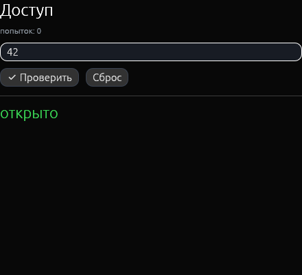
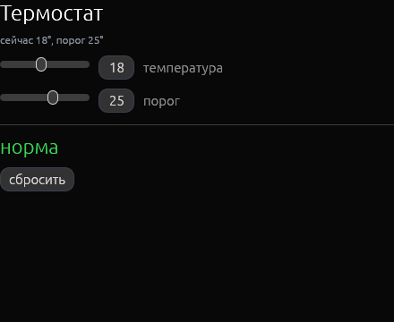

<p align="center">
  
</p>

<h1 align="center">lazr</h1>

<p align="center">
  <b>Интерфейс за 3 мс.</b> Модель экрана → настоящий код egui/eframe → сборка → проверка запуском.<br>
  Модель пишется строчными формами <em>или</em> S-выражениями. Rust остаётся HAL: окно, память, пиксели.
</p>

<p align="center">
  <b>Русский</b> · <a href="README.en.md">English</a>
</p>

<p align="center">
  <a href="https://github.com/kostyk348/lazr/actions"></a>
  <a href="https://kostyk348.github.io/lazr/"></a>
  
  
  
  
</p>

<p align="center">
  
</p>

---

## Что это даёт

Lazarus даёт человеку холст: перетащил кнопку, дважды кликнул, написал обработчик. **Агенту холст не нужен** —
ему нужен семантический способ менять интерфейс и проверяемый результат. `lazr` — это Lazarus для ИИ:

```
модель экрана (form.lazr / *.lisp)  →  настоящий проект egui/eframe  →  cargo build  →  verify
```

- **Одна правка — один факт.** `lazr add DIR button "Плюс" --do "count += 1"` меняет модель, а не файл на 800
  строк. Ошибка приходит данными: строка, код, подсказка.
- **Типы проверяются до сборки.** `append n 1` для `int`-поля — сообщение ««n» — не список, а int», а не паника
  в рантайме через минуту ожидания.
- **Генерация детерминированная.** Одна модель — один и тот же текст, поэтому сгенерированный код живёт в git
  и диффится как обычный код.
- **Проверка — запуском.** `verify` собирает проект, рисует кадр без окна и прогоняет каждое действие, печатая
  эффект: `items: [] → ["молоко"], done: 0 → 1`.
- **Живой режим.** `lazr live FILE` исполняет модель прямо сейчас: правишь файл — окно меняется без пересборки.

## Скорость (замеры на этой машине)

| Шаг | Время |
|---|---|
| модель → код (`lazr lisp`) | **3 мс** |
| код → собранное приложение (тёплый кэш) | **751 мс** |
| правка модели → пересборка | **410 мс** |
| проверка действий (`live --check`) | **89 мс** |
| весь набор тестов lazr | **18 мс** |
| самая первая сборка egui (пустой target) | 17 с |

Рабочий цикл: **правишь модель — видишь результат через полсекунды**, а не через «перезапусти IDE и подожди».

## За 10 минут до приложения

```bash
git clone https://github.com/kostyk348/lazr && cd lazr
cargo install --path .

# 1. живая модель: правишь файл — окно догоняет
lazr live examples/todo.lisp

# 2. из модели в настоящий проект и сразу запустить
lazr lisp examples/paint.lisp --to /tmp/paint
lazr run /tmp/paint

# 3. доказать, что работает: сборка + кадр + все действия
lazr verify /tmp/paint

# 4. для агента — то же по MCP
hermes mcp add lazr --command lazr --args mcp
```

## Кому это нужно

- **Агентам и их операторам** — когда интерфейс должен правиться командами и проверяться без человека.
- **Тем, кто пишет GUI на Rust** и устал от `ui.horizontal(|ui| { … })` на каждую строку раскладки.
- **Тем, кто делает внутренние инструменты**: пульты, формы, панели, «админки на один вечер».
- **Тем, кто не хочет ставить ничего лишнего**: инструмент — один бинарь, зависимостей в нём ноль.

## Что уже работает

| | |
|---|---|
| Раскладка | `vbox`, `hbox`, `grid N`, `scroll`, `space`, `place` с абсолютными точками, размерами и якорями |
| Стиль | размер, жирность, цвет, отступы, выравнивание, растяжение; тема строкой (тёмная/светлая, акцент, кегль, радиус) |
| Виджеты | `label`, `button`, `checkbox`, `text_input`, `slider`, `separator`, `space`, `list`, `custom` |
| Состояние | `int`, `float`, `bool`, `string`, `list` (список строк с удалением) |
| Логика | `if/else`, сравнения (включая строки), арифметика, `append/remove/clear`, `when … else` в раскладке |
| Проверка | `verify`, `live --check`, `--problems`, `--trace`, два состязательных скрипта для GUI |
| Упаковка | `lazr package` → бинарь + иконка из логотипа + `.desktop` + `tar.gz` |
| Для агента | MCP-сервер внутри: 8 инструментов, `lazr mcp` |

## Одна модель, два синтаксиса

Строчные формы удобны для точечных правок человеком и CLI; S-выражения — когда модель строит программа: одна
форма — одна операция, никаких кавычек и порядковых ловушек, а обработчик — форма, которую можно вычислить.

<table>
<tr><th>form.lazr</th><th>form.lisp</th></tr>
<tr><td><pre>
window "Счётчик" 420x260
state count int 0
label "Нажатий: {count}" {size:22, bold}
button "Плюс" do count += 1 {icon:play}
when count >= 3
  label "уже три" {size:12, color:#39d353}
else
  label "ещё мало" {size:12, color:#8b949e}
</pre></td><td><pre>
(window "Счётчик" 420 260)
(state count int 0)
(label "Нажатий: {count}" :size 22 :bold true)
(button "Плюс" (set! count (+ count 1)) :icon "play")
(when (>= count 3)
  (label "уже три" :size 12 :color "#39d353")
  (else (label "ещё мало" :size 12 :color "#8b949e")))
</pre></td></tr>
</table>

## Демки

Модель → живое приложение. Каждая демка проверяется машиной: `--problems` = 0, `verify` = сборка + кадр +
прогон всех действий.

| Файл | Что показывает |
|---|---|
| `paint.lisp` | Краски: 8 инструментов, палитра, отмена, заливка контура, файлы и системные диалоги |
| `dashboard.lisp` | Пульт: абсолютная раскладка `place`, якоря, тема, карточки |
| `todo.lisp` / `.lazr` | Задачи: список строк, `append`/`remove`/`clear`, поле ввода, счётчики |
| `gate.lisp` / `.lazr` | Доступ: сравнение строк и панели по условию |
| `thermostat.lisp` | Термостат: числа, пороги и `when … else` |
| `calc.lisp` | Смета: арифметика в обработчиках (`*`, `/`), ползунок шага |
| `settings.lisp` | Настройки: светлая тема, чекбокс, слайдер, поле ввода, `do` из двух присваиваний |
| `quiz.lisp` | Викторина: два счётчика, несколько действий в одной кнопке |
| `live-demo.lisp` / `.lazr` | Витрина рантайма: правишь файл — окно меняется без пересборки |

<p align="center">
  
  
</p>

## Списки

Поле `list` — это `Vec<String>`; в тексте `{items}` печатает количество, а виджет `list` рисует строки с
удалением. Три операции в действиях:

```lisp
(state items list)
(button "Добавить" (do (append items draft) (set! draft "")))
(button "Убрать первую" (remove items 0))
(button "Очистить" (clear items))
(list :bind items "пусто — добавьте первую задачу")
```

Типы проверяются: `append n 1` для `int`-поля — ошибка ««n» — не список, а int», а не паника в рантайме.

## Условия

`when` — контейнер: дети рисуются только когда условие истинно; `else` — вторая ветка. Условие компилируется
тем же языком, что и обработчики, поэтому ошибки типов видны до сборки.

```lisp
(when (>= score 3) (label "отлично" :color "#39d353"))
(when (!= code "42") (label "закрыто" :color "#e5484d"))
(when agree (label "согласие дано"))
```

```
when temp >= limit
  label "жарко" {size:22, color:#e5484d}
else
  label "норма" {size:22, color:#39d353}
```

Сравнения: `> < >= <= == !=`, включая строки (`code == "42"`), и поле-флаг без сравнения (`when agree`).

## Проверка — три факта, а не обещание

```bash
lazr verify DIR     # сборка + кадр в headless + вызов каждого действия, с эффектом
lazr live FILE --check     # «Плюс»: count: 0 → 1 — действия применяются в модели
lazr live FILE --problems  # что рантайм не понял (0 — всё понял)
lazr live FILE --trace     # click «Плюс»: count: 0 → 1 — трассировка нажатий в окне
```

`verify` печатает не «ok», а **что изменилось**:

```
$ lazr verify /tmp/ci-todo
сборка: ок
headless ok: 11 фигур, 11 виджетов в модели
действие «Добавить»: items: [] → [""]
действие «Готово»: done: 0 → 1
действие «Очистить»: items: [""] → []
selftest ok: 4 действий
итог: проверено
```

Для GUI есть два состязательных скрипта: `scripts/check-paint.py` (контур → заливка → пиксели → файл → чтение)
и `scripts/adversarial-paint.py` (6 атак: Ctrl+Z на пустой истории, 12 быстрых кликов, resize и т. д.).

## Упаковка

```console
$ lazr package /tmp/paint --release
binary: /tmp/paint/dist/kraski
icon:   /tmp/paint/dist/icon.png      # рендерится из docs/logo.svg
entry:  /tmp/paint/dist/kraski.desktop
archive:/tmp/paint/dist/kraski-release.tar.gz
```

## MCP

`lazr mcp` — JSON-RPC на stdin/stdout, восемь инструментов:

| инструмент | что делает |
|---|---|
| `form_new` | создать проект (модель + приложение) |
| `form_state` | объявить поле состояния |
| `form_add` | добавить виджет (тип, текст, привязка, действие, контейнер) |
| `form_show` | показать модель как текст |
| `form_widgets` | список виджетов с путями `/0/1` |
| `form_generate` | перегенерировать Rust |
| `form_build` | собрать и вернуть хвост лога |
| `form_headless` | исполнить кадр и вернуть число фигур |

Ответы всегда JSON; ошибки — `isError: true` с кодом и подсказкой, чтобы агент мог исправиться сам.

## Чем это отличается от других

| Инструмент | Что умеет | Чего не хватает |
|---|---|---|
| **Slint** (1.17+) | встроенный MCP: смотрит дерево запущенного окна, кликает, снимает скриншоты, headless | это **осмотр и управление**, а не авторство: экран всё равно пишется на `.slint` руками или агентом |
| **Ruxel Studio** (VS Code) | двусторонняя правка кода и канваса для iced/egui/slint/dioxus | живёт в редакторе, нет MCP, нет проверки исполнением |
| **iced** (`comet`, `cargo-hot`) | отладчик и горячая перезагрузка | для человека, не для агента |
| **Lazarus/Delphi** | компоненты, события, `.lfm` как модель формы | не Rust, нет MCP, проверка только человеком |
| **lazr** | модель + именованные операции + детерминированная генерация + проверка сборкой, кадром и прогоном действий + MCP | молодой: нет установщика и подписи, `custom` требует сборки |

## Чего здесь ещё нет (честно)

- **Свой виджет в живом режиме.** `custom` — это Rust-код, поэтому `lazr live` рисует вместо него честную
  заглушку «нужна сборка», а не молчит.
- **Раскладка как в Lazarus.** Абсолютные точки и два якоря есть; процентов, привязок к краям (как в Qt) и
  пересчёта при resize нет.
- **Стили как в CSS.** Шрифтов из файлов, теней и фоновых картинок нет.
- **Обработчики сложнее выражений.** Вызовов функций и работы с вложенными структурами нет — это уходит в
  `rust widget`, и тогда это уже не модель.
- **История модели.** Git есть; встроенного undo и ветвления модели нет.
- **Упаковка.** Установщика и подписи нет: подпись требует ключей, а не галочки в конфиге.
- **Шаблон строки списка.** Строка списка сейчас — текст с «✖»; свой шаблон строки (чекбокс, кнопки) — в планах.

## Установка

```console
$ cargo install --path .          # или: cargo build --release && cp target/release/lazr ~/.local/bin/
$ lazr new привет --title "Привет" --size 420x260
$ lazr state привет count int 0
$ lazr add привет label "Нажатий: {count}"
$ lazr add привет button "Плюс" --do "count += 1" --style "icon:play, key:ctrl+plus"
$ lazr verify привет
```

Общий `CARGO_TARGET_DIR` (`LAZR_TARGET_DIR`, по умолчанию `~/.cache/lazr/target`) экономит минуты: агент не
перекомпилирует egui на каждом шаге.

## Разработка

```bash
cargo test              # 51 тест: модель, раскладка, тема, язык действий, списки, when/else, S-выражения, генерация
cargo run -- demo       # сквозной прогон: модель → код → сборка → headless
cargo run -- live examples/todo.lisp   # живая модель
```

Лицензия: MIT.
