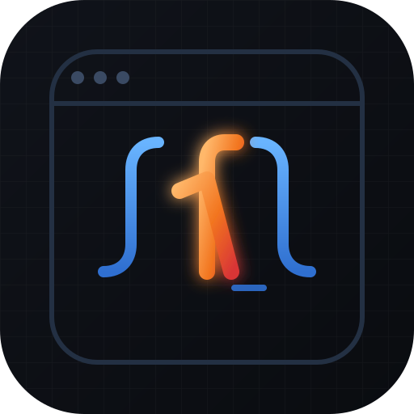
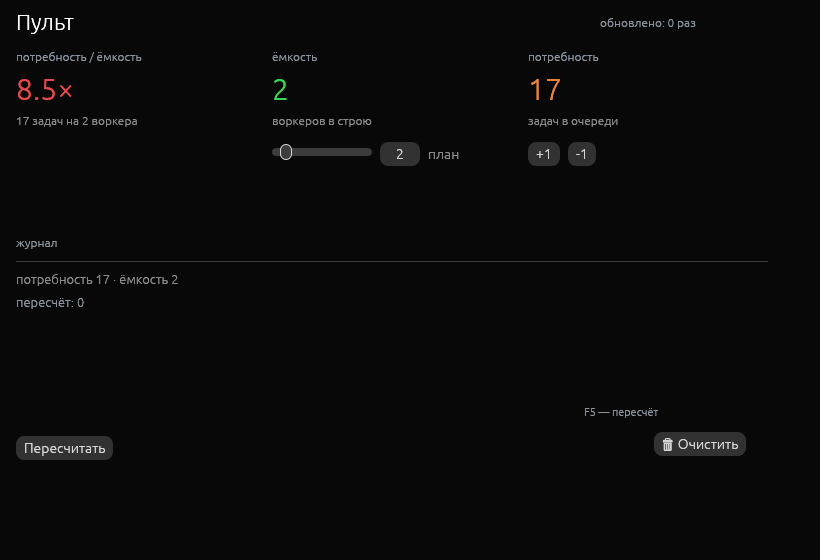
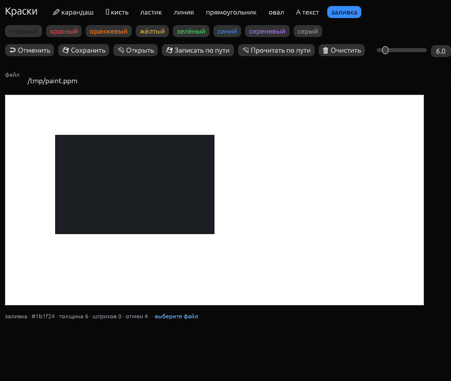

<p align="center">
  
</p>

<h1 align="center">lazr</h1>

<p align="center">
  RAD для Rust, дружелюбный к ИИ: модель экрана → настоящий код egui/eframe → сборка → проверка запуском.<br>
  Модель описывается строчными формами <em>или</em> S-выражениями. Rust остаётся HAL: окно, память, пиксели.
</p>

<p align="center">
  <b>Русский</b> · <a href="README.en.md">English</a>
</p>

<p align="center">
  <a href="https://github.com/kostyk348/lazr/actions"></a>
  <a href="https://kostyk348.github.io/lazr/"></a>
</p>

---

## Зачем

Lazarus даёт человеку холст: перетащил кнопку, дважды кликнул, написал обработчик. Агенту холст не нужен —
ему нужен **семантический** способ менять интерфейс и **проверяемый** результат. `lazr` делает ровно это:

```
модель экрана (form.lazr / *.lisp)  →  настоящий проект на egui/eframe  →  cargo build  →  verify
```

Ни драга мышью, ни «сгенерируй мне main.rs целиком». Каждая правка — именованная операция над моделью,
каждая ошибка — данные с номером строки, кодом и подсказкой. Генерация детерминированная: одна модель —
один и тот же текст, поэтому сгенерированный код можно держать в git и смотреть diff.

```bash
lazr new counter --title "Счётчик" --size 420x260
lazr state counter count int 0
lazr add counter label "Нажатий: {count}"
lazr add counter button "Плюс" --do "count += 1" --style "icon:play, key:ctrl+plus"
lazr verify counter        # сборка + кадр без окна + прогон всех действий
lazr mcp                   # то же самое для агента, по MCP
```

## Что умеет модель

| Что | Строчная форма | S-выражение |
|---|---|---|
| окно | `window "Краски" 900x720` | `(window "Краски" 900 720)` |
| поля | `state size float 4` | `(state size float 4)` |
| текст/кнопки | `label "x" {size:22, bold}` | `(label "x" :size 22 :bold true)` |
| действие | `button "Плюс" do count += 1` | `(button "Плюс" (set! count (+ count 1)))` |
| условие | `do if count >= 9 { count = 0 } else { count += 1 }` | `(if (>= count 9) (set! count 0) (set! count (+ count 1)))` |
| раскладка | `vbox`, `hbox`, `grid 2`, `scroll`, `space 12` | `(vbox …)`, `(grid 2 …)` |
| абсолютно | `place 800x480` + `at 16 50 size 240x170` | `(place 800 480 (vbox :at 16 50 :box 240 170 …))` |
| якоря | `anchor right bottom at 16 16` | `:anchor "right bottom"` |
| тема | `theme dark accent:#388bfd font:15 spacing:10 round:8` | `(theme dark :accent "#388bfd" :font 15)` |
| стиль | `{size:22, bold, color:#e5484d, pad:12, align:center, grow}` | `:size 22 :color "#e5484d" :pad 12` |
| иконка | `{icon:save}` | `:icon "save"` |
| горячая клавиша | `{key:ctrl+s}` | `:key "ctrl+s"` |
| свой виджет | `rust widget badge { … }` + `custom badge` | `(rust-widget badge """…""")` + `(custom badge)` |
| своё поле | `rust field strokes Vec<Stroke> Vec::new()` | `(rust-field strokes "Vec<Stroke>" "Vec::new()")` |
| своя функция | `rust fn parse_hex { … }` | `(rust-fn parse_hex """…""")` |
| код при старте | `rust init { … }` | `(rust-init """…""")` |

Виджеты модели: `label`, `button`, `checkbox`, `text_input`, `slider`, `separator`, `space`, `vbox`, `hbox`,
`grid`, `scroll`, `custom`. Иконки — встроенный набор из 40 имён (`save`, `open`, `undo`, `pencil`, `brush`,
`ellipse`, `fill`, `check`, `close`, …) без внешних зависимостей: глифы берутся из шрифтов egui.

Действия: `поле += N`, `поле -= N`, `поле = N`, `bool = !bool`, `string = "текст"`, а также `if` с арифметикой
и сравнениями. Привязки: `checkbox -> bool`, `text_input -> string`, `slider -> число`; тип проверяется до
компиляции.

Почему это дружит с ИИ:

* **текст вместо пикселей** — модель диффится в git, и по diff'у видно, что агент сделал;
* **ошибка — это данные**: `{"line":3,"code":"UNKNOWN_WIDGET","message":"…","hint":"доступны: …"}`;
* **тип проверяется до компиляции**: `text_input -> count` отклоняется сразу, а не через три минуты `cargo`;
* **генерация детерминированная**: одна модель — один и тот же код;
* **проверка без экрана**: `--headless` прогоняет кадр egui, а `--selftest` вызывает все действия;
* **ноль зависимостей у самого инструмента**: `lazr` — чистый stdlib Rust; сгенерированному приложению нужны только `egui`/`eframe`.

## Раскладка: как в форме, а не «на глазок»

`place` — это место фиксированного размера, внутри которого координаты абсолютные, а `anchor` считает их от
правого/нижнего края. Это то, чего не хватало: пульты, канвасы и панели теперь ставятся числами.

```lisp
(place 800 480
  (label "Пульт" at 16 10 size 200x28 :size 22 :bold true)
  (vbox :box 240 170 :at 16 50 (custom card))
  (button "Пересчитать" at 16 436 size 160x32 :icon "refresh" :key "ctrl+r")
  (button "Очистить" anchor right bottom at 16 16 size 130x32 :icon "delete"))
```

Тема — одна строка на модель: тёмная/светлая основа, акцент, размер шрифта, отступы, скругления. Она
компилируется в `fn apply_theme(ctx)` и применяется и в окне, и в головном кадре (поэтому тема тоже
проверяется, а не только описывается).



## Упаковка

```console
$ lazr package /tmp/paint --release
бинарь: /tmp/paint/dist/kraski
иконка: /tmp/paint/dist/icon.png
ярлык:  /tmp/paint/dist/kraski.desktop
архив:  /tmp/paint/dist/kraski-release.tar.gz
```

Имя пакета берётся из заголовка модели: русский заголовок транслитерируется (`Краски` → `kraski`), а не
превращается в безликое `app`. В `dist/` ложатся бинарь, `icon.png` (из `docs/logo.svg` через `rsvg-convert`), ярлык `.desktop` с `Name` из
заголовка модели и tar.gz. Установщика и подписи нет — это честная граница, а не забытая галочка.

## Проверка — три факта, а не обещание

```console
$ lazr verify /tmp/paint
сборка: ок
headless ok: 53 фигур, 18 виджетов в модели
  действие «Плюс»: ok
  действие «Сброс»: ok
selftest ok: 2 действий
итог: проверено
```

`verify` = компиляция + один кадр без окна + вызов **всех** действий кнопок. Свои виджеты проверяются кадром:
их код исполняется в `headless`, паника видна сразу.

## Демо: Краски

Полноценный Paint, целиком описанный моделью: 8 инструментов (карандаш, кисть, ластик, линия, прямоугольник,
овал, текст, заливка), палитра, толщина, отмена (Ctrl+Z), сохранение и открытие файла, горячие клавиши 1–8.

Заливка — не «закрасить всё»: холст держится растром, по всем штрихам строятся стены, и обход в ширину
красит только область внутри замкнутого контура. Файл — PPM; путь показан в строке «файл», его можно править,
а `F5` записывает и `F6` читает по этому пути. `Ctrl+S` и `Ctrl+O` (и `F7`) поднимают системный диалог
`zenity` — это удобство, а не единственный способ.

Проверка — не «на глаз», а скриптом `scripts/check-paint.py`:

```console
$ python3 scripts/check-paint.py
холст в окне: 11,190
внутри (27, 31, 36) · снаружи (255, 255, 255) → заливка OK
записано: /tmp/paint.ppm · 1053375 байт · 836x420 → OK
очистка True · чтение вернуло картинку True → round-trip OK
диалог открытия: поднялся

ИТОГ:
  заливка контура: works
  запись файла: works
  чтение файла (round-trip): works
  системный диалог открытия: works
```

Состязательный прогон `scripts/adversarial-paint.py` (атаки на контролы): пустая история отмен, отмена после
отмены, очистка, 12 быстрых кликов, resize — все атаки `works`, паник нет.



Исходник — `examples/paint.lisp`: около 300 строк, из них ~250 — Rust-код холста в `rust-item`; всё остальное —
формы DSL.

```lisp
(window "Краски" 900 720)
(state tool string "кисть")
(state size float 4)
(rust-field strokes "Vec<Stroke>" "Vec::new()")
(vbox :pad 12
  (hbox (label "Краски" :size 20 :bold true) (custom toolbar))
  (custom palette)
  (hbox (custom actions) (slider "толщина" :bind size :range (1 40)))
  (custom canvas)
  (custom status))
```

## `lazr live` — модель читается на ходу

```console
$ lazr live examples/live-demo.lazr
```

Собирается один рантайм (шаблон, без генерации под конкретный экран), дальше он запускается с путём к модели и
перечитывает файл, когда тот меняется: правишь модель — окно меняется, пересборки нет. Это первый шаг к тому
самому «Rust — HAL, остальное — DSL».

Сейчас в рантайме работают: окно, состояния, `label`, `button`, `checkbox`, `text_input`, `slider`, `space`,
`separator`, `vbox`, `hbox`, `grid`, `scroll`, стили `{size, bold, color}`, подстановки `{field}`.

Рантайм исполняет **S-выражения напрямую** — без конвертации в строчную модель и без супервизора:
обработчик хранится формой и вычисляется, а не пересказывается строкой (`(button "Плюс" (set! count (+ count 1)))`).
Понимает `set!`, `if` с `> < >= <= == !=`, `do`, арифметику с полями; сырые строки `"""…"""` (в них живёт
Rust-код генератора) пропускает. Строчная модель поддерживается так же — синтаксис определяется по первой
содержательной строке файла.

Нажатия можно отследить: `lazr live FILE --trace` печатает каждое применение обработчика —

```
click «Плюс»: count: 0 → 1
click «Плюс»: count: 1 → 2
```

Рантайм понимает и то, что раньше умел только генератор: `place` с абсолютными точками `at X Y`, размерами
`size WxH` и якорями `anchor right bottom`; строку `theme` (тёмная/светлая основа, акцент, кегль, отступы,
радиус); арифметику в действиях — `count = count + limit`, `limit = limit * 2`, `count -= count - 1`.
Блоки `rust widget/fn/init` рантайм пропускает: это код генератора, не модели.

Проверка без окна и без глаз:

```console
$ lazr live examples/live-demo.lazr --check
  «Плюс»: count: 0 → 1
  «Минус»: count: 1 → 0
  «Сброс»: без изменений (count = 0)
check ok: действий 3
```

`--check` применяет каждое действие модели к состоянию и печатает, какие поля изменились — то есть проверяет
эффект обработчиков так же, как `lazr verify` проверяет сгенерированное приложение. В окне проверено отдельно:
три клика по «Плюс» дают «Нажатий: 3 из 5», правка файла снаружи меняет окно без пересборки.

Модель с ошибками не ломает окно: рантайм показывает красную плашку с замечаниями («строка 5: виджет
«frobnicator» рантайм не знает», «поле «missing» не объявлено в state»), а `--problems` печатает их машинно и
возвращает код 1 — это проверяется в CI.

Править можно и `.lisp`: `lazr live model.lisp` держит рядом сконвертированную модель в актуальном виде, так что
правка S-выражений тоже подхватывается без пересборки (проверено: смена заголовка в `.lisp` меняет окно).

Чего в рантайме пока нет: `custom`-виджеты и `place` (они требуют генерации), сложные выражения в действиях —
там рантайм понимает присваивание, `+=`/`-=`, `!bool`, строки и `if` с одной ветвью.

## Списки

Поле типа `list` — это `Vec<String>`; в тексте `{items}` печатает количество, а виджет `list` рисует строки
с удалением. Три операции в действиях:

```lisp
(state items list)
(button "Добавить" (do (append items draft) (set! draft "")))
(button "Убрать первую" (remove items 0))
(button "Очистить" (clear items))
(list :bind items "пусто — добавьте первую задачу")
```

Типы проверяются: `append n 1` для `int`-поля — ошибка ««n» — не список, а int», а не паника в рантайме.

## Демки

Все лежат в `examples/` и все проверяются машиной (`lazr live <файл> --problems` → 0, `--check` показывает
эффект каждого действия):

| Файл | Что показывает |
|---|---|
| `paint.lisp` | Краски: 8 инструментов, палитра, отмена, заливка контура, файлы и системные диалоги |
| `dashboard.lisp` | Пульт: абсолютная раскладка `place`, якоря, тема, карточки |
| `calc.lisp` | Смета: арифметика в обработчиках (`*`, `/`), ползунок шага |
| `settings.lisp` | Настройки: светлая тема, чекбокс, слайдер, поле ввода, `do` из двух присваиваний |
| `quiz.lisp` | Викторина: два счётчика, несколько действий в одной кнопке |
| `todo.lisp` / `.lazr` | Задачи: список строк, `append`/`remove`/`clear`, поле ввода, счётчики |
| `live-demo.lisp` / `.lazr` | Витрина рантайма: правишь файл — окно меняется без пересборки |

Своего виджета в рантайме нет и быть не может (это Rust-код), поэтому `custom` рисуется честной заглушкой
«нужна сборка», а не пропадает молча.

## Установка

```console
$ cargo install --path .          # или: cargo build --release && cp target/release/lazr ~/.local/bin/
$ lazr new привет --title "Привет" --size 420x260
$ lazr state привет count int 0
$ lazr add привет label "Нажатий: {count}"
$ lazr add привет button "Плюс" --do "count += 1" --style "icon:play, key:ctrl+plus"
$ lazr verify привет
```

S-выражения:

```console
$ lazr lisp examples/paint.lisp                    # модель в текст
$ lazr lisp examples/paint.lisp --to /tmp/paint    # модель + проект + сгенерированный код
```

Общий `CARGO_TARGET_DIR` (`LAZR_TARGET_DIR`, по умолчанию `~/.cache/lazr/target`) экономит минуты: агент не
перекомпилирует egui на каждом шаге.

## MCP

`lazr mcp` — JSON-RPC на stdin/stdout, восемь инструментов:

| инструмент | что делает |
|---|---|
| `form_new` | создать проект (модель + приложение) |
| `form_state` | объявить поле состояния |
| `form_add` | добавить виджет (тип, текст, привязка, действие, контейнер) |
| `form_show` | показать модель как текст |
| `form_widgets` | список виджетов с путями `/0/1` |
| `form_generate` | перегенерировать Rust |
| `form_build` | собрать (`cargo build --offline`) и вернуть хвост лога |
| `form_headless` | исполнить кадр и вернуть число фигур |

Ответы всегда JSON; ошибки — `isError: true` с кодом и подсказкой, чтобы агент мог исправиться сам.

## Что уже есть у других и почему этого мало

| Инструмент | Что умеет | Чего не хватает |
|---|---|---|
| **Slint** (1.17+) | встроенный MCP: смотрит дерево запущенного окна, кликает, снимает скриншоты, headless-бэкенд | это **осмотр и управление**, а не авторство: экран всё равно пишется на `.slint` руками (или агентом) |
| **Ruxel Studio** (VS Code, alpha) | двусторонняя правка кода и канваса (`syn`/`quote`) для iced/egui/slint/dioxus | живёт в редакторе, нет MCP, нет проверки исполнением |
| **iced** (`comet`, `cargo-hot`) | отладчик и горячая перезагрузка | для человека, не для агента |
| **Lazarus/Delphi** | компоненты, события, `.lfm` как модель формы | не Rust, нет MCP, проверка только человеком |

`lazr` закрывает ровно дыру **авторства**: модель + операции + детерминированная генерация + проверка сборкой,
кадром и прогоном действий.

## Чего здесь ещё нет (честно)

* **раскладка**: есть `vbox`/`hbox`/`grid`/`scroll`/`place`, абсолютные точки, размеры и якоря right/bottom;
  нет процентов от контейнера, привязок к краям как в Qt и пересчёта формы при ресайзе окна;
* **стили**: есть размер, жирность, цвет, отступы, выравнивание и тема (шрифт, акцент, отступы, скругления);
  нет своих шрифтовых файлов, теней, картинок-фонов;
* **свои виджеты**: свой виджет — это блок Rust-кода; DSL для их внутренностей нет;
* **обработчики**: условия и арифметика есть, вызовов функций и списков нет — всё сверх этого уходит в
  `rust widget`, и тогда это уже не модель;
* **история модели**: git есть, встроенного undo/веток модели нет;
* **упаковка**: есть бинарь, иконка, `.desktop` и tar.gz; нет установщика и подписи — подпись требует ключей,
  а не галочки;
* **рантайм-Lisp**: S-выражения сегодня — язык автора, а не интерпретатор внутри приложения; Lisp-машина в
  полном смысле (правка форм без пересборки, горячая перезагрузка) — следующий шаг.

## Проверка — три факта, а не обещание

```console
$ lazr verify /tmp/paint
сборка: ок
headless ok: 53 фигур, 18 виджетов в модели
  действие «Плюс»: ok
  действие «Сброс»: ok
selftest ok: 2 действий
итог: проверено
```

`verify` = компиляция + один кадр без окна + вызов **всех** действий кнопок. Свои виджеты проверяются кадром:
их код исполняется в `headless`, паника видна сразу.

## Демо: Краски

Полноценный Paint, целиком описанный моделью: 8 инструментов (карандаш, кисть, ластик, линия, прямоугольник,
овал, текст, заливка), палитра, толщина, отмена (Ctrl+Z), сохранение и открытие файла, горячие клавиши 1–8.


Исходник — `examples/paint.lisp`: около 300 строк, из них ~250 — Rust-код холста в `rust-item`; всё остальное —
формы DSL.

```lisp
(window "Краски" 900 720)
(state tool string "кисть")
(state size float 4)
(rust-field strokes "Vec<Stroke>" "Vec::new()")
(vbox :pad 12
  (hbox (label "Краски" :size 20 :bold true) (custom toolbar))
  (custom palette)
  (hbox (custom actions) (slider "толщина" :bind size :range (1 40)))
  (custom canvas)
  (custom status))
```

## Установка

```console
$ cargo install --path .          # или: cargo build --release && cp target/release/lazr ~/.local/bin/
$ lazr new привет --title "Привет" --size 420x260
$ lazr state привет count int 0
$ lazr add привет label "Нажатий: {count}"
$ lazr add привет button "Плюс" --do "count += 1" --style "icon:play, key:ctrl+plus"
$ lazr verify привет
```

S-выражения:

```console
$ lazr lisp examples/paint.lisp                    # модель в текст
$ lazr lisp examples/paint.lisp --to /tmp/paint    # модель + проект + сгенерированный код
```

Общий `CARGO_TARGET_DIR` (`LAZR_TARGET_DIR`, по умолчанию `~/.cache/lazr/target`) экономит минуты: агент не
перекомпилирует egui на каждом шаге.

## MCP

`lazr mcp` — JSON-RPC на stdin/stdout, восемь инструментов:

| инструмент | что делает |
|---|---|
| `form_new` | создать проект (модель + приложение) |
| `form_state` | объявить поле состояния |
| `form_add` | добавить виджет (тип, текст, привязка, действие, контейнер) |
| `form_show` | показать модель как текст |
| `form_widgets` | список виджетов с путями `/0/1` |
| `form_generate` | перегенерировать Rust |
| `form_build` | собрать (`cargo build --offline`) и вернуть хвост лога |
| `form_headless` | исполнить кадр и вернуть число фигур |

Ответы всегда JSON; ошибки — `isError: true` с кодом и подсказкой, чтобы агент мог исправиться сам.

## Что уже есть у других и почему этого мало

| Инструмент | Что умеет | Чего не хватает |
|---|---|---|
| **Slint** (1.17+) | встроенный MCP: смотрит дерево запущенного окна, кликает, снимает скриншоты, headless-бэкенд | это **осмотр и управление**, а не авторство: экран всё равно пишется на `.slint` руками (или агентом) |
| **Ruxel Studio** (VS Code, alpha) | двусторонняя правка кода и канваса (`syn`/`quote`) для iced/egui/slint/dioxus | живёт в редакторе, нет MCP, нет проверки исполнением |
| **iced** (`comet`, `cargo-hot`) | отладчик и горячая перезагрузка | для человека, не для агента |
| **Lazarus/Delphi** | компоненты, события, `.lfm` как модель формы | не Rust, нет MCP, проверка только человеком |

`lazr` закрывает ровно дыру **авторства**: модель + операции + детерминированная генерация + проверка сборкой,
кадром и прогоном действий.

## Чего здесь ещё нет (честно)

* **раскладки-как-в-Lazarus**: есть `vbox`/`hbox`/`grid`/`scroll` и размеры, но нет якорей, привязок и
  абсолютных координат — для этого нужен свой решатель;
* **стилей-как-в-CSS**: есть размер, жирность, цвет, отступы, выравнивание, ширина; нет шрифтов, тем, теней,
  скруглений;
* **своих виджетов «без Rust»**: свой виджет — это блок Rust-кода; DSL для их внутренностей пока нет;
* **обработчиков со сложной логикой**: условия и арифметика есть, вызовов функций и списков нет;
* **истории модели**: git есть, встроенного undo/веток модели нет;
* **упаковки**: нет установщиков, иконок приложения и подписи бинаря;
* **рантайм-Lisp**: S-выражения сегодня — язык автора, а не интерпретатор внутри приложения; Lisp-машина в
  полном смысле (правка форм без пересборки, горячая перезагрузка) — следующий шаг.

## Проверка

```bash
cargo test        # 37 тестов: модель, раскладка, тема, язык действий, S-выражения, генерация
cargo run -- demo # сквозной прогон: модель → код → сборка → headless
```

Лицензия: MIT.
